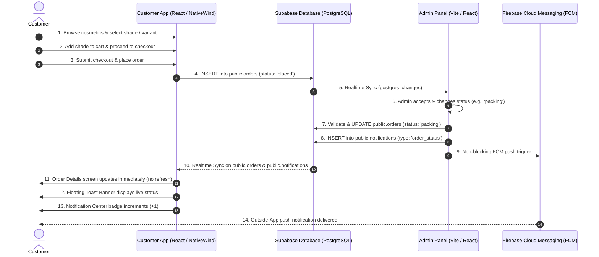

# SALBEAU MAKEUP STORE — ORDER MANAGEMENT & ARCHITECTURE AUDIT

## 1. Executive Summary & Audit Scope
This comprehensive architectural audit reviews the end-to-end makeup e-commerce workflow of the **Salbeau Luxury Makeup Store Application**, covering both the customer-facing mobile application and the administrative panel (`admin`).

The audit focuses on:
1. Complete order lifecycle and fulfillment workflow.
2. Real-time synchronization between Admin panel fulfillment actions and Customer mobile application views.
3. Dual-channel notification system: In-App Notification Center and outside-app Firebase Cloud Messaging (FCM) push notifications.
4. Clean removal of the "Employee Activity" option from navigation while safeguarding historical audit logs.
5. Absolute preservation of makeup product variants, shade swatches, pricing tiers, and inventory integrity.

---

## 2. End-to-End Makeup E-Commerce Order Lifecycle

### Detailed Stage Breakdown:
1. **Catalog Browsing & Shade Selection**:
   - The customer browses products categorized by category, brand, and skin tone.
   - For cosmetic products with color variations (e.g. Lipsticks, Foundations, Concealers), the user chooses a specific shade. Each shade includes a hex swatch (e.g. `#CE4270`), shade name (e.g. "Velvet Rose"), and SKU.
2. **Cart & Tier Pricing Calculation**:
   - The cart calculates line totals based on customer role tiers (General, Salon, Makeup Artist, Beautician) and bulk quantity discount rules.
3. **Checkout & Order Creation**:
   - The order payload is generated with a unique reference ID (e.g., `#ORD-928144`), complete item array containing snapshot product metadata, shade details, quantities, unit prices, and fulfillment status (`placed`).
4. **Admin Panel Order Ingestion**:
   - The Admin panel's `AdminContext` receives real-time PostgreSQL replication events. The order immediately displays in the order management grid with status `placed`.
5. **Fulfillment Transition & Validation**:
   - An authorized administrator reviews items and moves the order across valid fulfillment stages (`confirmed` → `processing` → `packing` → `ready_to_dispatch` → `out_for_delivery` → `delivered`).
   - Terminal states (`delivered`, `completed`, `cancelled`, `rejected`) are guarded against illegal backward transitions.
6. **Real-Time Customer Reflection**:
   - Supabase Realtime emits `postgres_changes` on `public.orders`. The customer app dynamically computes `currentFullOrder = displayOrders.find(o => o.id === selectedFullOrder.id)`, updating the timeline, stage note, and item indicators without manual page refresh.
7. **Customer Notification Center & FCM Push**:
   - An in-app notification record is inserted into `public.notifications`.
   - The Bell icon displays an unread count badge.
   - If the user is backgrounded or outside the app, FCM delivers a system push notification.

---

## 3. Database Schema & Infrastructure Analysis

### A. `public.orders` Table
- `id` (`TEXT PRIMARY KEY`): Unique order identifier.
- `user_id` / `phone` (`TEXT`): Customer identifier used for strict RLS and order filtering.
- `user_name` (`TEXT`): Customer display name.
- `status` (`TEXT`): Overall order fulfillment status (`placed`, `confirmed`, `processing`, `packing`, `ready_to_dispatch`, `out_for_delivery`, `delivered`, `partially_delivered`, `cancelled`, `rejected`).
- `items` (`JSONB`): Array of order item objects containing:
  - `product`: Product ID, name, brand, image URL.
  - `shade`: Shade name, hexColor swatch, variant SKU.
  - `quantity`: Quantity ordered.
  - `unitPrice`: Captured unit price at time of purchase.
  - `status`: Individual item fulfillment status for multi-shipment tracking.
- `status_history` (`JSONB`): Immutable audit array recording each status change with timestamp and actor.
- `rejection_reason` (`TEXT`): Recorded rejection reason if rejected by store.

### B. `public.notifications` Table
- `id` (`TEXT PRIMARY KEY`): Unique notification ID.
- `user_id` (`TEXT`): Targeted customer phone or user ID.
- `target` (`TEXT`): Target audience (`customer`, `admin`, `all`).
- `title` (`TEXT NOT NULL`): Clean, customer-facing notification headline.
- `message` (`TEXT NOT NULL`): Professional notification body.
- `type` (`TEXT`): Event category (`order_status`, `payment`, `cancellation`, `refund`, `general`).
- `data` (`JSONB`): Deep link metadata (`orderId`, `orderNumber`, `eventType`, `amount`).
- `is_read` (`BOOLEAN DEFAULT false`): Read/unread flag.
- `created_at` (`TIMESTAMPTZ`): Realtime ordering timestamp.
- *Realtime Publication*: Added to `supabase_realtime` publication for instant streaming.

### C. `public.order_status_history` Table
- Audit ledger recording order state transitions with `order_id`, `status`, `title`, `customer_message`, `changed_by`, `changed_at`.

---

## 4. Employee Activity Removal Audit
- **Admin Navigation Cleanup**:
  - Removed `{ id: 'employees/activity', label: 'Employee Activity' }` from `AdminSidebar.jsx` and `App.jsx`.
  - Removed dashboard shortcuts, quick navigation tabs, and dropdown references.
  - In `EmployeeProfilePage.jsx`, redirected "Full Activity Feed →" to `audit_trail` (system audit log).
- **Broken Route Safeguard**:
  - Any stale link or manual URL pointing to `employees/activity` automatically redirects safely to `employees` (`EmployeesListPage`).
- **Data Preservation**:
  - All employee audit logs and `employee_activity_logs` tables remain completely intact in the PostgreSQL database. No audit records were purged.

---

## 5. Variant & Shade Integrity Audit
Makeup orders inherently rely on precise shade variants. The audit confirmed:
- Swatches are rendered using exact hexadecimal colors stored at order creation (e.g. `item.shade.hexColor`).
- Status updates (e.g. changing from `processing` to `packing`) perform targeted updates on item fulfillment states while strictly preserving `product`, `shade`, `quantity`, and `unitPrice`.
- Role-based discount prices (B2B vs B2C) are immutably captured at order creation and cannot be mutated by status changes.

